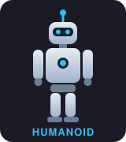
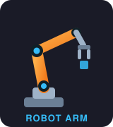

<!-- Header banner -->


<p align="center">
  <a href="https://github.com/Quangvuisme">
    
  </a>
</p>

<p align="center">
  <a href="https://www.linkedin.com/in/quang-vu-394420337/"></a>
  <a href="mailto:vuquangcl8a@gmail.com"></a>
  
</p>

---

### 🧑‍💻 About me

```js
const quang = {
  name:      "Vu Dinh Quang",
  location:  "Vietnam 🇻🇳",
  field:     "Robotics 🤖",
  interests: ["control systems", "embedded systems", "robot perception"],
  funFact:   "I turn coffee ☕ into moving robots 🦾",
};
```

### 🛠️ Tech stack

<p align="center">
  
</p>

### 🤖 Robots I work with

<p align="center">
  
  
  
</p>

### 📊 GitHub

<p align="center">
  
</p>

<!-- Footer banner -->

